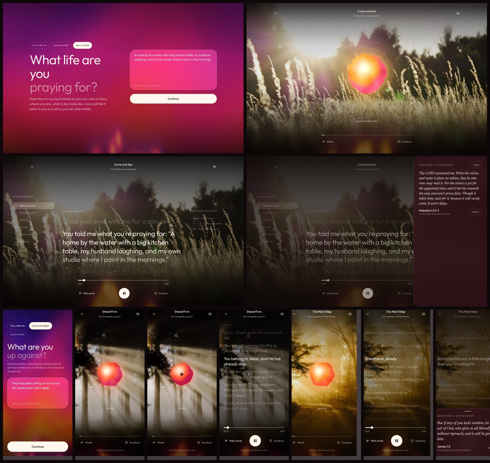

# Liora

*A quiet place to pray.*

Liora is a progressive web app for guided prayer and Scripture meditation, made for women who want to pray, reflect, and speak God's promises without the noise of secular wellness culture. She shares what is on her heart and chooses a kind of moment (a prayer, a prayer of spiritual warfare, or a vision of the life she is praying for told as a story); Liora writes a short session around a real passage of Scripture and reads it to her in a calm voice while the words scroll past like lyrics over slow, warm light. It is designed for phone, tablet and desktop.

"Liora" is a working name (Hebrew, *my light*). It appears in a handful of places listed in [docs/ARCHITECTURE.md](docs/ARCHITECTURE.md#renaming-the-app).



## Run it

```bash
npm install
npm run build
npm start
```

Open http://localhost:8787. For development with hot reload, run the API and the client in two terminals:

```bash
npm run dev:server
```

```bash
npm run dev
```

### Keys

The app works with no keys at all, and gets better with each one you add. Copy `.env.example` to `.env`.

| Key | Without it | With it |
| --- | --- | --- |
| `ANTHROPIC_API_KEY` | Sessions are assembled on the device from a hand-written library of twelve themes | Claude writes each session around what she actually shared |
| `ELEVENLABS_API_KEY` | The device's built-in speech voice reads the session | Studio narration, with exact line-by-line timing |

Scripture is never generated in either mode. It always comes from the verified verse library.

## Deploy to Netlify

It is live at https://liora-prayer.netlify.app. The repository is ready for Netlify: `netlify.toml` builds the PWA into `dist/`, and `netlify/functions/api.mts` serves `/api/*` as a function. Connect the repository in Netlify (Add new site → Import an existing project), choose the branch, and deploy; no settings need changing. To deploy by hand instead: `npx netlify-cli build --offline` then `npx netlify-cli deploy --prod --no-build --dir dist --functions .netlify/functions`. Add `ANTHROPIC_API_KEY` and `ELEVENLABS_API_KEY` under Site configuration → Environment variables to turn on Claude writing and studio narration.

Two things differ from running `npm start`: the in-memory rate limit does not apply to functions, and a function has a short time limit, so a slow writing request falls back to the on-device library.

## What is here

| Path | What it is |
| --- | --- |
| `src/screens/` | The seven screens: splash, onboarding, home, intention, voice, creating, player |
| `src/lib/engine.ts` | The playback engine: one clock that drives audio, lyrics and the scrubber |
| `src/content/` | Themes, the verse library, and the on-device composer |
| `server/` | The API (Claude for writing, ElevenLabs for voice) and an Express host for it |
| `netlify/` | The same API as a Netlify Function |
| `scripts/` | Asset and content pipelines (loops, icons, verses) |
| `assets-src/higgsfield/` | The original gradient stills generated with Higgsfield |
| `docs/` | Architecture, styling, content guidelines, and where this is going |

## Docs

- [Architecture](docs/ARCHITECTURE.md) — how the pieces fit, and why
- [Styling](docs/STYLING.md) — the design language and its tokens
- [Credits](docs/CREDITS.md) — photographs and other assets, with licences
- [Content](docs/CONTENT.md) — voice, theology guardrails, and the Scripture pipeline
- [Vision](docs/VISION.md) — what comes next

## Scripts

| Command | Does |
| --- | --- |
| `npm run dev` / `npm run dev:server` | Client with hot reload / API with reload |
| `npm run build` | Type-check and build the PWA into `dist/` |
| `npm start` | Serve `dist/` and the API from one process |
| `npm run lint` | Lint |
| `npm run content:verses` | Rebuild the verse library from the public-domain source |
| `npm run assets:loops` | Re-render the looping backdrops from the stills |
| `npm run assets:icons` | Re-render the app icons |
